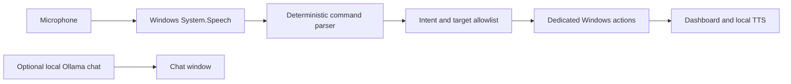

# POVA — Personal Operating Voice Assistant

POVA is a modular Python desktop assistant for Windows 10 and Windows 11. It recognizes a finite grammar of PC commands using Windows System.Speech, converts those commands to structured intents, checks each intent against an allowlist, and performs only the matching action. It does not send recognized speech to a shell.

## Features

- Dark neon Tkinter assistant dashboard with a custom animated robot, listening visualizer, live status, microphone controls, command guide, and session history.
- Windows-native speech recognition and local SAPI text-to-speech using an installed female voice; no PyAudio, API key, or always-on online speech service.
- Optional contextual AI chat powered by local Ollama; chat is isolated from Windows command execution and stays in the open window's memory.
- Recognition grammar and deterministic parser for applications, websites, known folders, Windows control, media, time/date, and confirmed power operations.
- Safe application discovery, website and folder allowlists, screenshot capture, and Windows multimedia-key controls.
- Local JSON settings, a microphone test, timeout-aware confirmations, logging, and graceful worker shutdown.

## Architecture



Recognized text is never interpolated into a PowerShell command. The only PowerShell scripts are fixed source strings used to access Windows System.Speech; recognized text and TTS text are passed as standard input data. Executable actions use predefined arguments with `shell=False`.

## Project structure

```text
POVA/
├── actions/       # Allowlisted app, browser, system, media, and power actions
├── assets/        # Application icon
├── config/        # App mappings and validated local settings
├── core/          # Intents, parser, security boundary, orchestration
├── tests/         # Platform-independent unit and security tests
├── ui/            # Tkinter app, dashboard, settings, command history
├── utils/         # Logging and shared helpers
├── voice/         # Windows speech input, manager, and local SAPI TTS
├── main.py
├── pyproject.toml
└── requirements.txt
```

## Requirements and installation

- Windows 10/11 and Python 3.10 or newer.
- Windows microphone privacy access and an installed Windows speech-recognition language.
- Pillow for screenshots. PyAudio is not used or required.
- Ollama is optional and required only for AI Chat. Install it from [ollama.com](https://ollama.com), then download the default model:

```powershell
ollama pull llama3.2
```

Open PowerShell in the `POVA` directory and run:

```powershell
python -m venv .venv
.\.venv\Scripts\Activate.ps1
python -m pip install --upgrade pip
python -m pip install -r requirements.txt
```

If activation is blocked, use `Set-ExecutionPolicy -Scope Process Bypass` in PowerShell, then activate again. These are PowerShell commands; Python source code belongs in `.py` files and should not be typed into the PowerShell prompt.

## Run

```powershell
python main.py
```

POVA also starts on non-Windows hosts to display its platform-support message; microphone and Windows actions require Windows 10/11.

## Example commands

| Say | Result |
| --- | --- |
| “Hey POVA, open Notepad” | Opens Notepad |
| “Launch Calculator” | Opens Calculator |
| “Open VS Code” | Opens VS Code when installed |
| “Open Downloads” | Opens the known Downloads folder |
| “Open YouTube” | Opens a configured website |
| “Lock my computer” | Locks the current Windows session |
| “Take a screenshot” | Saves a timestamped PNG to the configured screenshot directory |
| “Volume up” / “Mute” | Sends the Windows multimedia key |
| “Play” / “Next track” | Sends the Windows media key |
| “What time is it?” / “What is today’s date?” | Reads the local time or date |
| “Shutdown” / “Restart” / “Sleep” / “Hibernate” | Asks for explicit confirmation first |

Manual listening mode accepts commands without a wake word. Unknown phrases, arbitrary URLs, arbitrary paths, and requests that combine an allowed app with extra shell-like instructions are rejected.

Select **AI Chat** in the dashboard to open a separate local conversation. The default Ollama endpoint is `http://127.0.0.1:11434` and the default model is `llama3.2`; both can be changed in Settings, but the endpoint must remain on the local machine. Chat requires Ollama to be running. The conversation is held in memory only while its window is open. Chat replies cannot launch applications or perform Windows actions.

## Settings and privacy

Use **Settings** in the dashboard to configure recognition and phrase timeouts, the wake word, local voice response, session history, auto-listening, screenshot directory, and Ollama endpoint/model. POVA listens to the Windows default recording device. Settings are stored in `%APPDATA%\\POVA\\settings.json` (or `~/.config/POVA/settings.json` when that environment variable is unavailable). Command history and AI conversations are kept only in memory and are not written to disk. The log at `logs/pova.log` records application and intent events, not recognized speech, microphone audio, or chat prompts.

## Security

- Speech is parsed into a typed intent and validated against known intent, application, website, and directory registries.
- The app starts a process only with a fixed argument list and `shell=False`; voice text is never executed as a command.
- Website commands can open only configured HTTPS destinations; folder commands can open only known user folders or the configured POVA project directory.
- Shutdown, restart, sleep, and hibernate need a fresh “yes”/“confirm” response within 30 seconds. “No”, “cancel”, or “stop” cancels them.
- Unsupported speech is displayed as `UNKNOWN` and never executed.
- AI chat sends prompts only to the configured loopback Ollama service. AI responses are displayed as text and are never interpreted as commands.

## Troubleshooting

- **Microphone unavailable:** enable microphone access in Windows Privacy & security settings and select a working default input device.
- **No clear command recognized:** use **Test Microphone**, speak a listed example, and confirm a Windows speech language is installed.
- **Speech recognition unavailable:** verify that PowerShell and Windows System.Speech are available on your Windows installation.
- **Application not found:** install the application or add its executable to `PATH`; optional applications are also searched in common install locations.
- **Screenshot failed:** choose a writable screenshot location in Settings and ensure Pillow is installed.
- **Settings invalid:** POVA reports the configuration issue before opening with safe defaults for that run.
- **AI chat unavailable:** install/start Ollama, run `ollama pull llama3.2` (or choose an installed model in Settings), and confirm the endpoint is local.

## Tests and development

Install development dependencies and run tests from the `POVA` directory:

```powershell
python -m pip install -r requirements-dev.txt
pytest
python -m compileall .
```

Tests do not require a real microphone or Windows. Voice integration can be mocked; Windows-specific operations are platform-guarded.

## Packaging

PyInstaller is optional and is not a normal runtime dependency. From this directory, a Windows executable can be built with:

```powershell
pyinstaller --windowed --name POVA main.py
```

## Roadmap

The speech backend interface is isolated so an offline recognizer can be added later. POVA has no mandatory LLM, network speech service, or API credentials.
